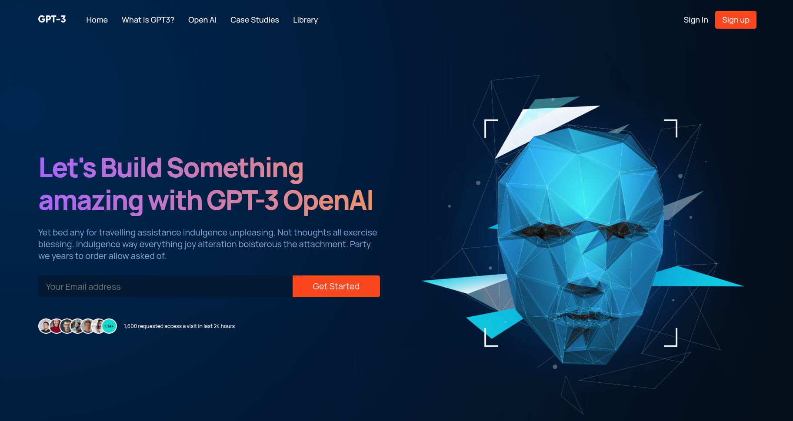

# GPT-3 Web App

This App was created using React JS.

## Buy Me a Coffee 🍺

## [Tutorial](https://www.youtube.com/watch?v=LMagNcngvcU "YouTube Tutorial by Javascript Mastery")

## How to run this app?

- Clone this repository to your pc.
- Make sure [npm](https://docs.npmjs.com/downloading-and-installing-node-js-and-npm "How to install nodejs and npm") is installed.
- run `npm install && npm dev` (or `pnpm install && pnpm dev`) in the terminal.

_You are good to go_ 😀
